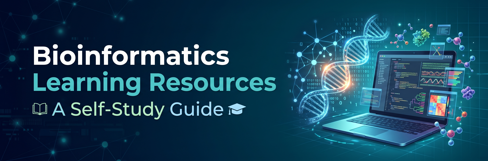

A collection of useful resources for learning bioinformatics, including online courses, tutorials, books, and practical tools. The materials cover programming, statistics, command-line skills, and specialized bioinformatics applications.

---

## 📚 Table of Contents

- [Unix and Shell](#unix-and-shell)
- [R Programming](#r-programming)
- [Python Programming](#python-programming)
- [Statistics](#statistics)
- [Git and Version Control](#git-and-version-control)
- [RNA-seq](#rna-seq)
- [Single-cell Analysis](#single-cell-analysis)
- [Read Mapping](#read-mapping)
- [Variant Calling](#variant-calling)
- [Miscellaneous](#miscellaneous)

---

## Unix and Shell

### Beginner

- [Greg Wilson's YouTube Videos on the Unix Shell](https://www.youtube.com/watch?v=U3iNcBtycaQ)
- [Introduction to the Command Line for Genomics](https://datacarpentry.org/shell-genomics/)
- [A Short Introduction to grep](https://informatics.fas.harvard.edu/short-introduction-to-grep.html)
- [Lockdown Learning - Bioinformatics](https://www.youtube.com/playlist?list=PLzfP3sCXUnxEu5S9oXni1zmc1sjYmT1L9)

### Intermediate

- [Advanced Beginner/Intermediate Shell](https://github.com/ngs-docs/2016-adv-begin-shell-genomics)

### Advanced

- [Unofficial Bash Strict Mode](http://redsymbol.net/articles/unofficial-bash-strict-mode/)
- [Better Bash Scripting in 15 Minutes](http://robertmuth.blogspot.com/2012/08/better-bash-scripting-in-15-minutes.html?m=1)
- [Bash Pitfalls](http://mywiki.wooledge.org/BashPitfalls)

**Process Substitution**
- [Using Names Pipes and Process Substitution in Bioinformatics](http://vincebuffalo.org/blog/2013/08/08/using-names-pipes-and-process-substitution-in-bioinformatics.html)
- [Handy Bash Feature: Process Substitution](https://medium.com/@joewalnes/handy-bash-feature-process-substitution-8eb6dce68133#.uz5pj9yer)

**Bioinformatics One-Liners**
- [Steven Turner](https://github.com/stephenturner/oneliners)
- [Ming (Tommy) Tang](https://github.com/crazyhottommy/bioinformatics-one-liners)

---

## R Programming

### Beginner

- [Data Analysis for the Life Sciences](http://rafalab.github.io/pages/harvardx.html)
- [Introduction to Computational Biology](https://biodatascience.github.io/compbio/)

### Intermediate

- [Introduction to Bioconductor](https://www.edx.org/course/introduction-to-bioconductor-annotation-and-analys)
- [R for Data Science](https://r4ds.had.co.nz/)

### Advanced

- [Advanced Bioconductor](https://www.edx.org/course/advanced-bioconductor)
- [Advanced R](https://adv-r.hadley.nz/)
- [Bioconductor Courses and Conferences](https://www.bioconductor.org/help/course-materials/)

---

## Python Programming

### Beginner

- [Using Python for Research](http://rafalab.github.io/pages/harvardx.html)
- [Biology Meets Programming: Bioinformatics for Beginners](https://www.coursera.org/learn/bioinformatics)

### Intermediate

- [Intermediate Python](https://github.com/yasoob/intermediatePython)
- [CheckiO](https://py.checkio.org/)

### Advanced

---

## Statistics

- [Modern Statistics for Modern Biology](http://web.stanford.edu/class/bios221/book/index.html)

---

## Git and Version Control

- [GitHub Learning Lab](https://lab.github.com/)
- [How to Write a Git Commit Message](https://chris.beams.io/posts/git-commit/)
- [Happy Git and GitHub for the useR](http://happygitwithr.com/)
- [Learn Git Branching](http://learngitbranching.js.org/)
- [A Git Workflow Walkthrough Series](http://vallandingham.me/git-workflow.html)
- [A Quick Introduction to Version Control with Git and GitHub](http://journals.plos.org/ploscompbiol/article?id=10.1371/journal.pcbi.1004668)
- [Ten Simple Rules for Taking Advantage of Git and GitHub](http://journals.plos.org/ploscompbiol/article?id=10.1371%2Fjournal.pcbi.1004947)
- [Software Carpentry Git Novice Lesson](http://swcarpentry.github.io/git-novice/)
- [Git Best Practices](https://sethrobertson.github.io/GitBestPractices/)
- [GitHub Cheatsheet](https://github.com/tiimgreen/github-cheat-sheet#readme)
- [Git in Practice](https://github.com/GitInPractice/GitInPractice#readme)

**Git Troubleshooting**
- [Oh Shit, Git!](http://ohshitgit.com/)
- [How to Undo (Almost) Anything with Git](https://github.com/blog/2019-how-to-undo-almost-anything-with-git)
- [Git Flight Rules](https://github.com/k88hudson/git-flight-rules)

---

## RNA-seq

---

## Single-cell Analysis

- [Harvard Informatics One-Day Intro](https://crazyhottommy.github.io/scRNA-seq-workshop-Fall-2019/)
- [Guided Analyses with Seurat](https://satijalab.org/seurat/vignettes.html)

---

## Read Mapping

---

## Variant Calling

- [Harvard Informatics: FASTQ to VCF](https://informatics.fas.harvard.edu/whole-genome-resquencing-for-population-genomics-fastq-to-vcf.html)
- [RAD-seq: Reference Assembly](http://www.ddocent.com/assembly/)
- [RAD-seq: SNP Filtering](http://www.ddocent.com/filtering/)

---

## Miscellaneous

- [Understanding Snakemake](https://vincebuffalo.com/blog/2020/03/04/understanding-snakemake.html)
- [A Primer for Computational Biology](https://open.oregonstate.education/computationalbiology/)
- [Fundamentals of Data Visualization](https://serialmentor.com/dataviz/)
- [GCP for Bioinformatics](https://github.com/lynnlangit/gcp-for-bioinformatics)
- [Team Teri](https://github.com/lynnlangit/TeamTeri)
- [SLiM Workshops](http://benhaller.com/workshops/workshops.html)

---

## Acknowledgments and Credits

A big thank you to all the authors, researchers, educators, developers, and organizations who have created and shared these valuable learning resources.

Please acknowledge and cite the original authors and sources whenever you use these materials. Collecting, organizing, and compiling educational resources requires considerable time, effort, and dedication. This collection would not be possible without their hard work and contributions to the bioinformatics community.

**Please support the original creators by visiting their resources, citing their work, and giving proper credit wherever it is due.**

Happy learning, and thank you to everyone who makes knowledge freely accessible! ❤️
